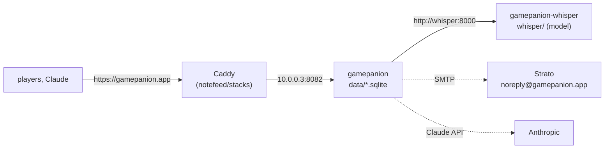

# Operating gamepanion.app

gamepanion.app is Gamepanion from `gamepanion/` of this repository, on `products-1` (Hetzner, with notefeed.me and gesetze-fuer-ki.de), checked out at `/srv/stacks/gamepanion/`. `MarcelBruckner-Business/ansible` deploys it: it writes `gamepanion/.env` from its vault, starts the containers, installs whisper's model, routes the name through Caddy (in `notefeed/stacks`), sets the DNS records at Cloudflare (proxy off, Caddy's own certificates) and runs the backups. Its `docs/products-1.md` has the commands.



## Settings

Every setting is in `gamepanion/.env`, written by the deployment from its vault; `.env.example` lists the names. Sign-in is by emailed code and link, then a passkey; no OpenID provider. `PUBLIC_URL` is `https://gamepanion.app`: passkeys are bound to it, and so is every connected Claude.

## Upgrading

A Dependabot pull request bumps the image in `compose.yaml`. Merge it, then deploy (`ansible-playbook site.yml --limit products-1`). The deployment takes a dump before it touches a changed checkout or `.env`; if that fails, nothing is changed. Gamepanion migrates its databases when it starts.

## whisper

speaches with `Systran/faster-whisper-small` (int8, about 500 MB in memory, at most 1.5 of the 2 vCPUs): `products-1` has 4 GB shared by three products, so the large model Gamepanion defaults to does not fit. speaches transcribes only models installed into `gamepanion/whisper/`; the deployment installs `GAMEPANION_TRANSCRIBE_MODEL` once (`POST /v1/models/<id>`), and the files stay there. Changing the model is that setting in the vault and a deployment.

## Backups

`gamepanion/scripts/dump.sh <kind> <days>` writes `data/dumps/<kind>-<time>/` with consistent, checked copies of `gamepanion.sqlite` and `auth.sqlite`. Timers on the server, set up by the deployment:

| Kind           | When                                                | Kept on the server |
| -------------- | --------------------------------------------------- | ------------------ |
| hourly         | every hour                                          | 1 day              |
| daily          | 03:15                                               | 30 days            |
| before-upgrade | each deployment that changes the checkout or `.env` | 1 day              |

Every night the newest daily dump also goes to the business's Storage Box (restic, `products-1`'s sub-account, tag `gamepanion`, 29 days), with notefeed's copy. A failed run alerts the ntfy topic; a run that doesn't happen is noticed by its healthchecks.io check.

`GAMEPANION_SECRET` is in no backup: it is in the vault and in 1Password. A dump without it restores the logs, but every browser and every Claude has to sign in again.

## Restore

With Gamepanion stopped, from a dump on the server (`dump.sh` says the same):

```sh
cd /srv/stacks/gamepanion/gamepanion
docker compose stop gamepanion
rm -f data/*.sqlite-wal data/*.sqlite-shm
cp data/dumps/<kind>-<time>/gamepanion.sqlite data/dumps/<kind>-<time>/auth.sqlite data/
docker compose start gamepanion
```

From the Storage Box: restore the newest snapshot tagged `gamepanion` into a folder (as root, the commands in `docs/products-1.md` of the deployment repository) and copy the two files the same way.

## Logs and monitoring

The container logs go to Loki on `gewerbe-1` with the server's other logs. Uptime Kuma watches `/health` past Caddy (the `kuma.*` labels in `compose.yaml`) and `https://gamepanion.app` through Caddy (the labels in `notefeed/stacks`' Caddy). Caddy counts requests per host name for Prometheus.
